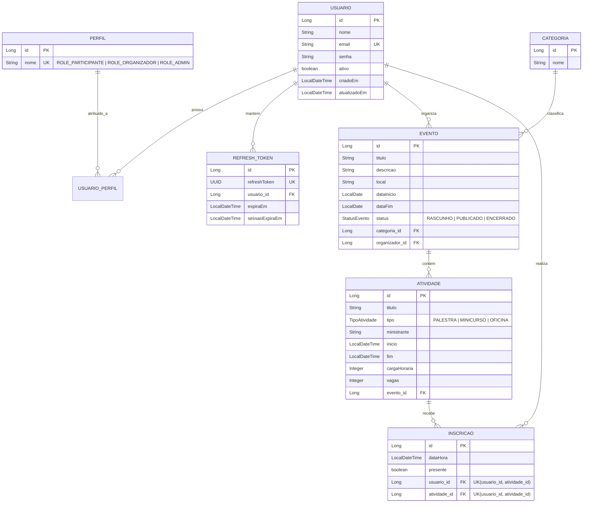

# Arquitetura do Sistema — EventIF

## 1. Visão Geral

O **EventIF** é uma aplicação web monolítica modular desenvolvida com **Java 21** e **Spring Boot 3.5.16** para divulgação de eventos acadêmicos (semanas de curso, congressos, jornadas), gerenciamento de inscrições em atividades, controle de presença e emissão de certificados.

O sistema atende a quatro perfis de acesso:
- **Visitante (Anônimo):** consulta eventos publicados e realiza autocadastro como participante.
- **Participante (`ROLE_PARTICIPANTE`):** inscreve-se em atividades, cancela inscrições e emite certificados das atividades em que teve presença registrada.
- **Organizador (`ROLE_ORGANIZADOR`):** cria e gerencia seus próprios eventos e atividades, além de registrar a presença dos inscritos.
- **Administrador (`ROLE_ADMIN`):** gerencia categorias de eventos e cadastra/define organizadores e administradores.

---

## 2. Stack Tecnológica

| Camada | Tecnologia |
| :--- | :--- |
| **Linguagem & Runtime** | Java 21 |
| **Framework Principal** | Spring Boot 3.5.16 (Spring MVC) |
| **Renderização Web (SSR)** | Thymeleaf + `thymeleaf-extras-springsecurity6` |
| **Persistência & ORM** | Spring Data JPA / Hibernate 6 |
| **Versionamento de Banco** | Flyway (`V1` a `V8`) |
| **Banco de Dados** | PostgreSQL 16 (Produção/Dev) / H2 (apenas escopo `test`) |
| **Segurança** | Spring Security 6 + JWT (`java-jwt`) em Cookies `HttpOnly` + Refresh Token |
| **Documentação da API** | Springdoc OpenAPI / Swagger UI |
| **Infraestrutura** | Docker & Docker Compose |

---

## 3. Arquitetura em Camadas

O projeto segue o padrão de arquitetura em camadas no pacote base `com.eventif`:

```text
com.eventif
├── configuracao.security  # SecurityConfiguration (SecurityFilterChain) e SecurityFilter (validação JWT via cookie)
├── controller             # Endpoints HTTP/MVC (AuthController, OrganizadorController, AdminController, etc.)
├── dto                    # Objetos de transferência e validação de entrada/saída (Records com Jakarta Validation)
├── exception              # Tratamento global de erros (@RestControllerAdvice) e exceções de domínio
├── model                  # Entidades JPA e Enums do domínio
├── repository             # Interfaces Spring Data JPA
└── service                # Regras de negócio, autenticação, emissão/rotação de tokens e manipulação de cookies
```

---

## 4. Modelo de Dados (Entidades JPA e Relacionamentos)

O modelo de domínio contempla as **6 entidades obrigatórias** especificadas (`Usuario`, `Perfil`, `Categoria`, `Evento`, `Atividade`, `Inscricao`) mais a entidade de suporte à sessão segura (`RefreshToken`):



> **Nota sobre Certificados:** O certificado não é uma entidade persistida; ele é gerado dinamicamente a partir dos registros de `Inscricao` com `presente = true`.

---

## 5. Autenticação e Autorização

1. **Login (`POST /auth/login`):**
   - Valida credenciais (`BCryptPasswordEncoder`) e se o usuário está `ativo`.
   - Emite um **Access Token JWT** (curta duração, 15 min) salvo no cookie `HttpOnly` `jwt_token_eventif` (`Path=/`).
   - Emite um **Refresh Token** persistido no banco (1h de validade, limite de sessão de 8h) salvo no cookie `HttpOnly` `jwt_refresh_token_eventif` (`Path=/auth`).
2. **Filtro de Requisições (`SecurityFilter`):**
   - Intercepta cada requisição, lê o cookie `jwt_token_eventif`, valida a assinatura HMAC256 do JWT, carrega a entidade `Usuario` ativa do banco e popula o `SecurityContextHolder`.
3. **Renovação (`POST /auth/refresh`) e Logout (`DELETE /auth/logout`):**
   - O refresh rotaciona o UUID do `RefreshToken` no banco e emite novos cookies.
   - O logout remove o `RefreshToken` do banco e limpa os dois cookies (`Max-Age=0`).
4. **Regras de Acesso por Rota (`SecurityConfiguration`):**
   - **Públicas (`permitAll`):** `/`, `/eventos/**`, `POST /auth/login`, `POST /auth/cadastro-participante`, `POST /auth/refresh`, `DELETE /auth/logout` e Swagger (`/swagger-ui/**`, `/v3/api-docs/**`).
   - **Organizador (`ROLE_ORGANIZADOR`):** `/organizador/**` (exceto `POST /organizador/cadastro`, restrito a `ROLE_ADMIN`).
   - **Administrador (`ROLE_ADMIN`):** `/admin/**` e `POST /organizador/cadastro`.
   - **Demais rotas:** exigem usuário autenticado (`anyRequest().authenticated()`).

---

## 6. Migrations do Banco de Dados (Flyway)

O schema é validado pelo Hibernate (`spring.jpa.hibernate.ddl-auto=validate`) e gerenciado pelo **Flyway**, dividido por perfil do Spring (`SPRING_PROFILES_ACTIVE`):

### Migrations de Schema e Perfis (`src/main/resources/db/migration/` — `dev` e `prod`)
- `V1__CREATE_TABLE_USUARIOS.sql` — Tabela `usuarios`
- `V2__CREATE_TABLE_PERFIS.sql` — Tabelas `perfis` e `usuario_perfil` (`@ManyToMany`)
- `V3__CREATE_TABLE_REFRESH_TOKEN.sql` — Tabela `refresh_token`
- `V4__CREATE_TABLE_CATEGORIAS.sql` — Tabela `categorias`
- `V5__CREATE_TABLE_EVENTOS.sql` — Tabela `eventos`
- `V6__CREATE_TABLE_ATIVIDADES.sql` — Tabela `atividades`
- `V7__CREATE_TABLE_INSCRICOES.sql` — Tabela `inscricoes` com constraint única `(usuario_id, atividade_id)`
- `V8__INSERT_PERFIS.sql` — Carga inicial dos perfis `ROLE_PARTICIPANTE`, `ROLE_ORGANIZADOR` e `ROLE_ADMIN`

### Migrations de Desenvolvimento (`src/main/resources/db/dev/` — apenas `dev` via `application-dev.properties`)
- `R__INSERT_USUARIOS_TESTE.sql` — Migration repetível que cria os 3 usuários de teste (`admin@eventif.com`, `organizador@eventif.com`, `participante@eventif.com`) com senhas criptografadas via `pgcrypto` (BCrypt).
